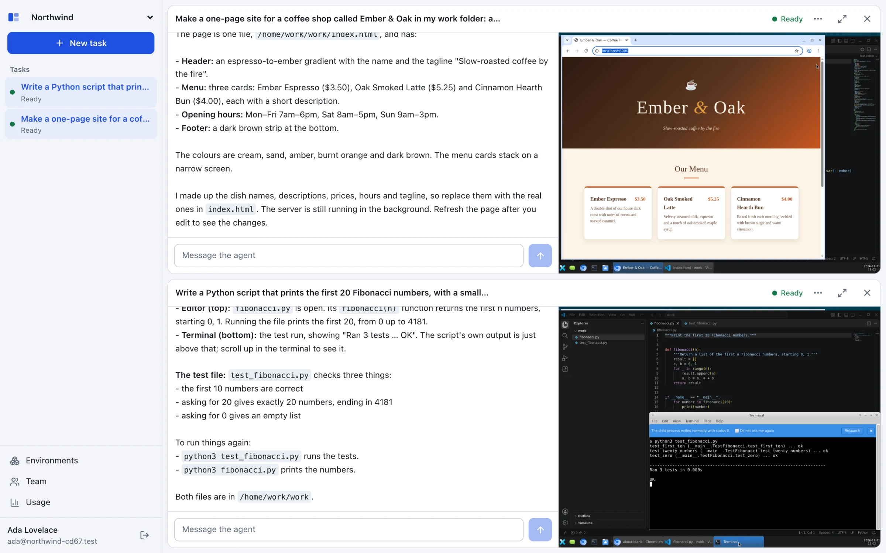
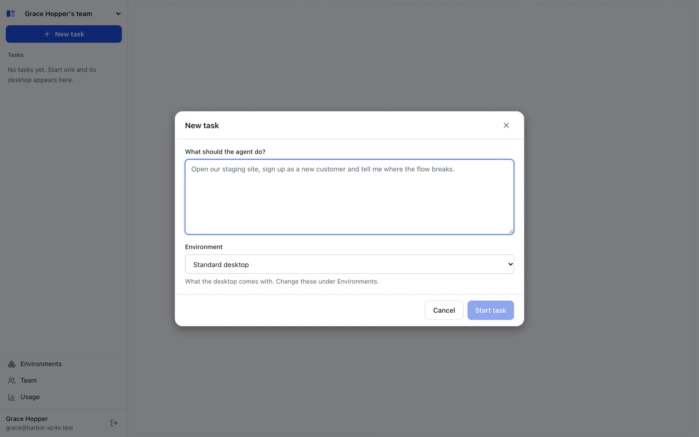
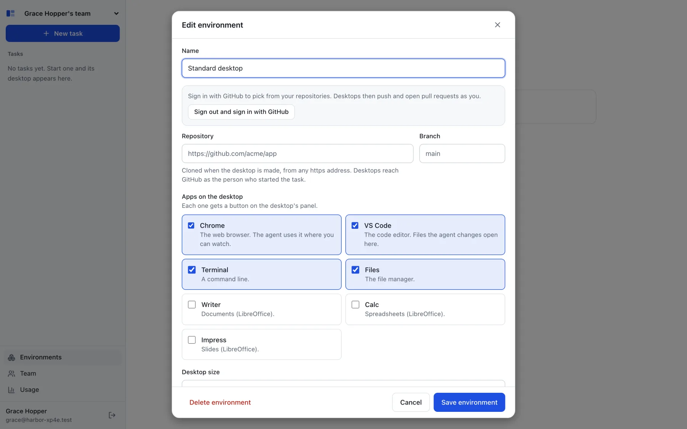

# Workstream

Workstream gives every task its own Linux desktop in the cloud with an AI agent working on it. You write what you want done. A fresh desktop starts, and the agent gets to work in a real browser, VS Code and a terminal while you watch the screen live. You can talk to it as it goes, or grab the mouse and do something yourself.



## Why it's useful

An agent with a whole computer can do more than one in a terminal. It can click through a web app to find a bug, run a project's full stack in Docker, or fill in a spreadsheet. Because every task has its own desktop, you can start several at once and none of them gets in the way of your own machine. You can also see exactly what each one did, and take over when one gets stuck.

I built Workstream over a weekend in November 2026. It's open source now in case it's useful to someone, or as an example of how to build this kind of app.

## What it does

- Each task gets its own desktop, with Chrome, VS Code, a terminal and a file manager. Up to four tasks fit on your screen at once.
- The agent is built on the Claude Agent SDK. You can see everything it does on the desktop.
- An environment decides what a desktop starts with: which apps, a repository, a setup script and some instructions for the agent. You can keep it in the repository as a `workstream.yml` file.
- If you sign in with GitHub, the agent works on a branch and opens a pull request as you.
- A team shares its tasks and environments. You can also share one task with someone outside the team, by email, so they can watch it, talk to the agent or use the desktop.
- A desktop pauses when nobody has used it for half an hour and picks up where it left off when you come back.





## Built on SqlOS

Workstream is also my example app for [SqlOS](https://github.com/ross-slaney/sqlos), a .NET library I wrote. It puts sign-in, organizations and permissions inside your own SQL Server database. Workstream has no users table and no permission logic of its own. Every question about who can do what is answered by SqlOS.

Here's how the pieces map:

- A team is a SqlOS organization, and its people are one group.
- Every team, environment and task is a node in one tree, so a grant on a team covers all of its tasks.
- Sharing a task with someone outside the team is a single grant on that task. If you share it for a week, the grant ends after a week.
- Each desktop signs in as its own service account. Its key reaches its own task and nothing else, so a desktop can't read another team's work even if the agent on it tries.
- The task list and the conversation are read as authorized pages. SqlOS filters the rows by permission inside the query. A team's people hold one grant on the team, so the permission check stays one index read however many tasks the team has.

The whole model is written down in [docs/core-model.md](docs/core-model.md). That's the best place to start if you want to see how an app built on SqlOS fits together.

## Try it on your computer

On your computer, each desktop is a Docker container instead of a cloud machine. You'll need Docker, the .NET 10 SDK, Node 22, about 10 GB of free disk and an [Anthropic API key](https://console.anthropic.com).

```bash
cd client && npm ci && cd ..
docker build -t workstream-desktop:local desktop    # a few minutes the first time
cp .env.example .env
```

Set these two lines in `.env`:

```
WORKSTREAM_MODEL_ENDPOINT=https://api.anthropic.com
WORKSTREAM_MODEL_KEY=<your Anthropic API key>
```

Then start it:

```bash
dotnet run --project apphost
```

Open http://localhost:8091/sign-in?view=signup and create an account with any email and password. Then press **New task**.

## Running your own

Workstream runs on Azure: Container Apps for the API and the web app, a virtual machine for each desktop, and Azure SQL. A fork deploys itself from GitHub Actions once you've run a setup script and set a few values. It costs about $100 to $125 a month with nobody using it, plus each desktop's hours. [docs/self-hosting.md](docs/self-hosting.md) walks through it step by step. It also covers the command line, the tests and how releases work.

## How it's put together

| Folder | What's in it |
| --- | --- |
| `api/` | The .NET 10 API. It also carries each desktop's screen to the browser, passes the agent's model calls on to Claude and runs the background jobs. |
| `client/` | The web app, built with Expo. |
| `desktop/` | The desktop image and the agent that runs on it. |
| `cli/` | A small command line for starting tasks from a terminal. |
| `infra/` | Bicep for everything in Azure. |
| `tests/` | Tests that go through the API as each kind of user and check what they're allowed to do. |
| `docs/` | [The core model](docs/core-model.md) and [how the pieces fit](docs/architecture.md). |

## License

MIT. See [LICENSE](LICENSE).
